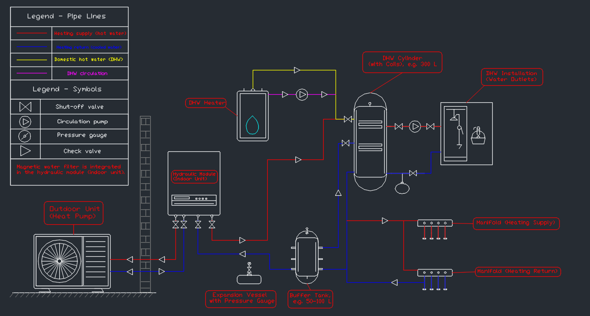
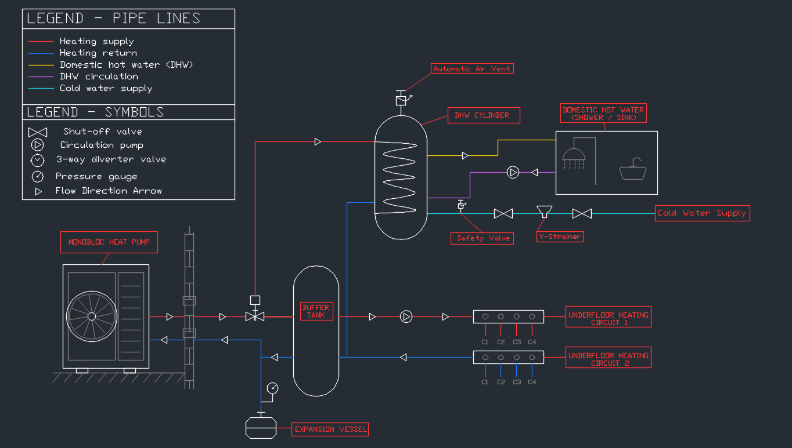

# AutoCAD Residential HVAC Systems Project

A small CAD portfolio project presenting three residential heating system concepts. The drawings demonstrate 2D technical drafting, equipment representation, pipe routing, symbols, annotations, legends, and the visual organization of engineering schematics.

The project compares three approaches to supplying space heating and domestic hot water (DHW):

1. Air-to-water heat pump - split system
2. Air-to-water heat pump - monobloc system
3. Gas condensing boiler system

> **Project scope:** These are illustrative portfolio schematics. They communicate the general arrangement and operating concept of each system; they are not installation or construction drawings.

---

## 01 - Panasonic Aquarea Split R32

**Concept:** Air-to-water split heat pump with a separate indoor hydraulic module.



**Main equipment and features**
- Outdoor unit: Panasonic WH-UDZ09KE5
- Indoor hydraulic module: Panasonic WH-SDC0309K6E5
- Buffer tank: Panasonic PAW-BTANK50L-2 (50 L)
- DHW cylinder: Panasonic PAW-TA30C2E5STD (300 L)
- Underfloor heating distribution with two circuits
- Color-coded heating, DHW, and refrigerant connections

[Open the DWG drawing](Drawings/01_Panasonic_Aquarea_Split_R32_Underfloor_Heating.dwg)

---

## 02 - Air-to-Water Monobloc

**Concept:** Monobloc heat pump system with water connections between the outdoor unit and the building.



**Main equipment and features**
- Outdoor monobloc heat pump unit
- Buffer tank
- Indirect DHW cylinder with internal heat exchanger coil
- Cold-water supply and DHW safety components
- Underfloor heating distribution with two circuits
- Color-coded heating flow, heating return, DHW, DHW circulation, and cold-water supply

[Open the DWG drawing](Drawings/02_Air_to_Water_Monobloc_Underfloor_Heating.dwg)

---

## 03 - Gas Condensing Boiler

**Concept:** Gas-fired heating system with an indirect DHW storage cylinder.


**Main equipment and features**
- Gas condensing boiler
- Flue gas / air intake representation
- Gas supply and condensate drain
- Indirect DHW storage cylinder with heat exchanger coil
- Three-way diverter valve for DHW priority
- DHW safety group and cold-water supply
- Heating expansion vessel and pressure gauge
- Underfloor heating distribution with two circuits

[Open the DWG drawing](Drawings/03_Gas_Condensing_Boiler_Underfloor_Heating.dwg)

---

## CAD Skills Demonstrated

- 2D CAD drafting and geometric construction
- Technical equipment outlines and simplified component symbols
- Pipe routing with orthogonal line layouts
- Layers, colors, and line-type organization
- Annotation, labels, leaders, and legends
- Repeated components and aligned manifold connections
- Composition and readability of technical schematics

## Tools and File Formats

- AutoCAD-compatible 2D drafting workflow
- DWG drawings
- PNG previews for repository documentation

## Repository Structure

```text
AutoCAD_Residential_HVAC_Systems_Project/
├── Drawings/
│   ├── 01_Panasonic_Aquarea_Split_R32_Underfloor_Heating.dwg
│   ├── 02_Air_to_Water_Monobloc_Underfloor_Heating.dwg
│   └── 03_Gas_Condensing_Boiler_Underfloor_Heating.dwg
├── Previews/
│   ├── 01_Panasonic_Aquarea_Split_R32_Underfloor_Heating.png
│   ├── 02_Air_to_Water_Monobloc_Underfloor_Heating.png
│   └── 03_Gas_Condensing_Boiler_Underfloor_Heating.png
└── README.md
```

## Disclaimer

The schematics are prepared for learning and portfolio presentation. They do not replace manufacturer installation manuals, hydraulic calculations, gas/flue design, safety assessments, or project-specific engineering documentation. Equipment selection, pipe sizing, protective devices, connections, and installation details must be independently verified by a qualified designer for any real installation.

---

**Category:** Engineering / HVAC / AutoCAD  
**Project type:** 2D technical drafting portfolio  
**Drawings:** 3
