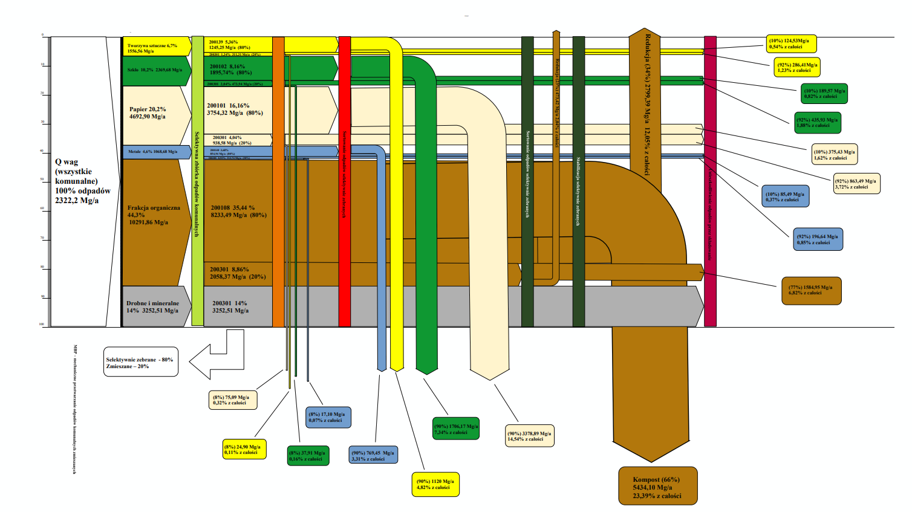
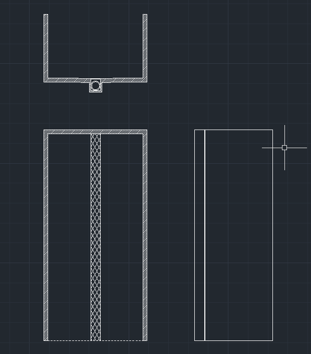
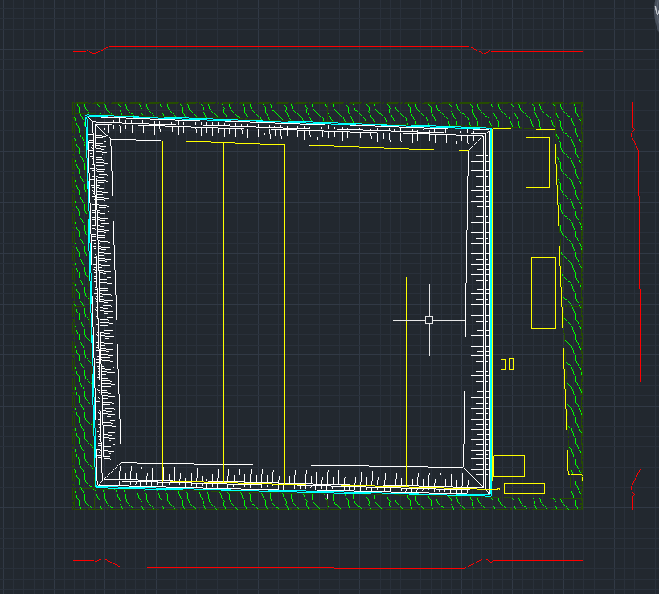

# Municipal Waste Management and Landfill Engineering Project

A university engineering project focused on municipal waste generation, waste composition, treatment flows, aerobic stabilization, and preliminary landfill planning. It combines spreadsheet calculations, a Sankey diagram, and 2D CAD drawings.

> **Scope:** This is an educational and portfolio study. The calculations and drawings are illustrative and do not constitute construction, permitting, or operating documentation.

## Project scope

1. **Waste generation and composition** – organize the available population, waste quantity, and material-fraction data.
2. **Waste-flow analysis** – present the treatment and recovery routes in a Sankey diagram.
3. **Aerobic stabilization** – review the mixed-waste quantity and the source calculation for reactor volume and capacity.
4. **Landfill planning** – examine the waste forecast, preliminary landfill layout / capacity calculations, and wind-rose / green-belt material.
5. **CAD documentation** – include drawings of the stabilization reactor and landfill basin.

## Selected results from the supplied material

| Indicator | Reported value |
|---|---:|
| Study-area population | 79,000 |
| Annual municipal waste mass | 23,232.2 Mg/year |
| Annual municipal waste volume | 122,100 m³/year |
| Reported bulk density | 190.27 kg/m³ |
| Largest waste fraction | Organic fraction – 44.3% |
| Mixed waste considered for aerobic stabilization | 7,394.67 Mg/year |
| Stabilization period used in the source calculation | 8 weeks |
| Indicative reactor count in the source calculation | about 8 units (6 × 3 × 13 m = 234 m³ each) |
| Forecast combined waste volume | 123.36 → 136.93 thousand m³/year (2026 → 2041) |

These values are transcribed from or summarized from the supplied study materials. They should be treated as preliminary until the source-data inconsistencies listed in [`Report.md`](Report.md) are resolved.

## Visual documentation

### Waste-flow Sankey diagram

Mass-flow diagram of the municipal waste stream: material fractions (plastics, glass, paper, metals, organics, fines/minerals), selective collection vs. mixed waste (80% / 20% split), sorting, stabilization, and the resulting recovery and residual streams (compost, reduction, landfilled fractions).

<p align="center">
  
</p>

> The diagram is kept as supplied (labels in Polish). The total in the left-hand box reads "2322,2 Mg/a", which appears to be a typo for 23,232.2 Mg/a – the percentages and fraction masses in the diagram are consistent with the larger value.

### Aerobic stabilization reactor

Section and plan views of the aerobic stabilization reactor (drawing: [`Drawings/Reactor.dwg`](Drawings/Reactor.dwg)).

<p align="center">
  
</p>

### Landfill basin / site layout

Plan view of the landfill basin with embankments, cells, the green belt around the site, and the service area on the right (drawing: [`Drawings/Landfill_Basin.dwg`](Drawings/Landfill_Basin.dwg)).

<p align="center">
  
</p>

## Repository structure

```
02_Municipal_Waste_Management_Project/
├── README.md
├── Report.md                      # extended technical report + data-quality review
├── Drawings/
│   ├── Reactor.dwg                # aerobic stabilization reactor
│   └── Landfill_Basin.dwg         # landfill basin
├── Previews/
│   ├── Sankey.png                 # waste-flow Sankey diagram
│   ├── Reactor.png.png            # reactor CAD preview
│   └── Landfill_Forecast.png      # landfill basin CAD preview
└── Source_Files/
    ├── tab.1.xlsx                 # waste generation
    ├── tab. 2.xlsx                # waste composition
    └── wykres_Sankeya.xlsx        # Sankey + stabilization calculations
```

## Drawings and source files

| File | Description |
|---|---|
| [`Drawings/Reactor.dwg`](Drawings/Reactor.dwg) | Aerobic stabilization reactor drawing |
| [`Drawings/Landfill_Basin.dwg`](Drawings/Landfill_Basin.dwg) | Landfill basin drawing |
| [`Source_Files/tab.1.xlsx`](Source_Files/tab.1.xlsx) | Waste generation by subgroup, annual volume and mass |
| [`Source_Files/tab. 2.xlsx`](<Source_Files/tab. 2.xlsx>) | Waste composition by fraction |
| [`Source_Files/wykres_Sankeya.xlsx`](Source_Files/wykres_Sankeya.xlsx) | Sankey diagram and stabilization / reactor calculations |
| [`Report.md`](Report.md) | Extended technical report: methodology, calculation summaries, conclusions, and issues requiring verification |

## Skills demonstrated

- Spreadsheet-based engineering calculations and data organization
- Municipal waste generation and composition analysis
- Mass-flow representation using a Sankey diagram
- Preliminary aerobic stabilization and reactor sizing
- Landfill forecasting and preliminary capacity / area analysis
- Wind-rose data review
- 2D CAD drafting and technical drawing presentation
- Technical reporting and data-quality review

## Limitations and items for review

The supplied material contains unresolved inconsistencies in subgroup labels (ZC / ZJ) and some waste-composition calculations. The Sankey stream boundaries, reactor assumptions, landfill-area calculations, and wind-rose frequency data also require verification. These issues are documented in [`Report.md`](Report.md) (Section 10); the reported values should not be treated as approved design inputs.

---

**Category:** Environmental Engineering / Waste Management / AutoCAD  
**Project type:** University engineering study and technical portfolio  
**Included drawings:** 2 DWG files  
**Included calculation workbooks:** 3 XLSX source files
