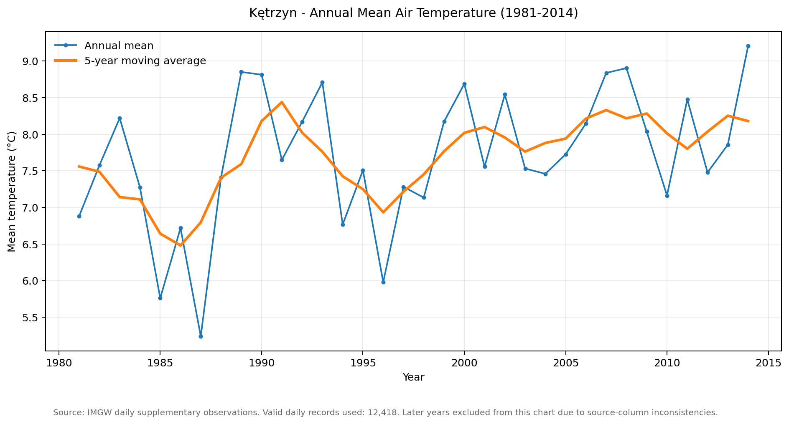
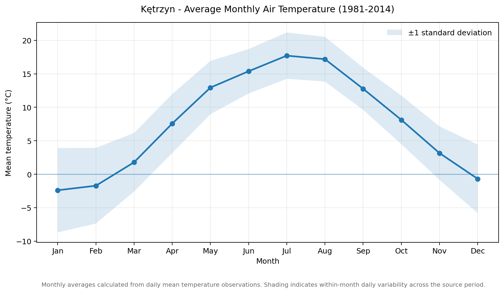
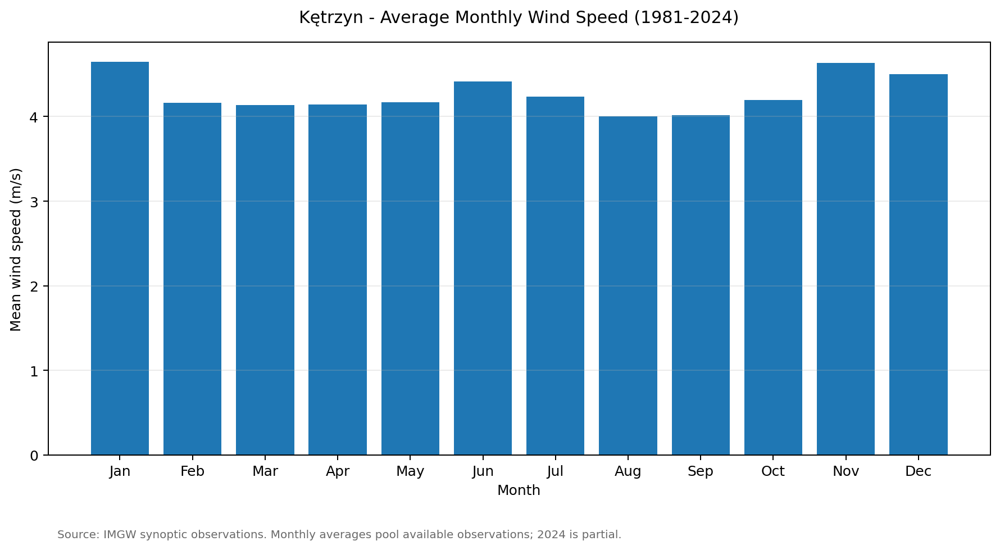
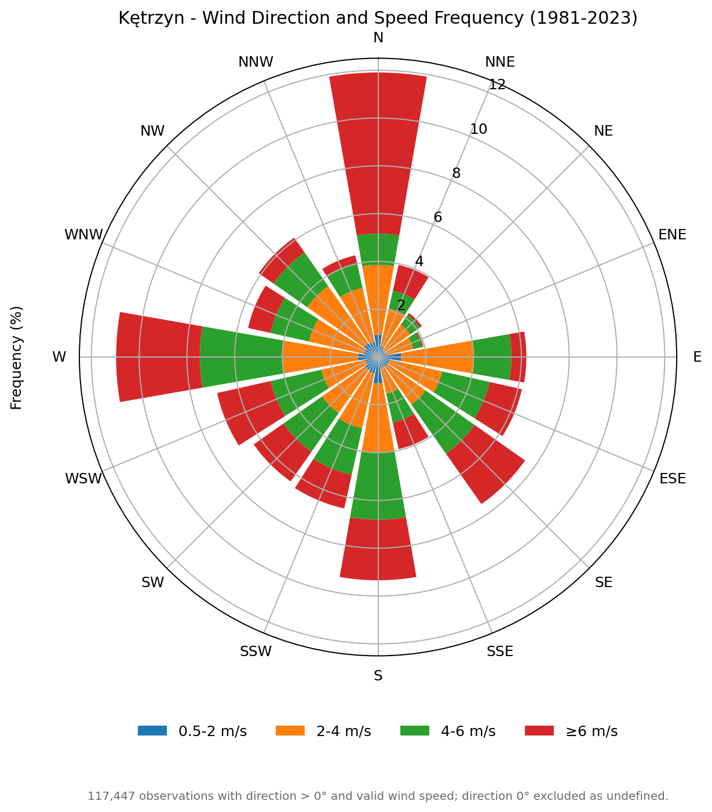

# Kętrzyn Climate Data Analysis (1981-2024)

## 1. Introduction

This report presents an exploratory analysis of historical meteorological observations from the **Kętrzyn weather station in Poland**. The study is based on meteorological datasets covering different observation periods between 1981 and 2024.

The main objective is to examine selected weather characteristics, including air temperature, wind speed and wind direction, and to identify seasonal patterns and variations over time.

The analysis uses daily and synoptic observations published in the meteorological datasets attributed to IMGW.

## 2. Data Sources and Scope

The study uses three types of meteorological datasets:

| Dataset | Main observations | Coverage |
|---|---|---|
| `KETRZYN_DOBOWE_SD.xlsx` | Daily temperature, precipitation, sunshine duration and snow-related parameters | 1981-2024 |
| `KETRZYN_DOBOWE_SDT.xlsx` | Daily supplementary observations, including temperature, wind, cloud cover, humidity and atmospheric pressure | 1981-2024 (partial) |
| `KETRZYN_TERMIN.xlsx` | Synoptic observations, including wind, temperature, humidity and atmospheric conditions | 1981-2024 |

The datasets contain different observation frequencies and parameters. Consequently, not all variables have identical periods of availability or the same number of valid records.

The analysis presented in this report focuses on four visualizations:

- Annual mean air temperature.
- Average monthly air temperature.
- Average monthly wind speed.
- Wind direction and speed frequency.

## 3. Air Temperature Analysis

### 3.1 Annual Mean Air Temperature (1981-2014)

The annual temperature series shows considerable year-to-year variability throughout the analyzed period.

Several relatively cool years are visible during the second half of the 1980s, with the lowest annual mean appearing around 1987. Higher annual averages occur in several later periods, particularly during the late 1980s, around 2000 and in the second half of the 2000s.

The five-year moving average helps reduce short-term fluctuations and makes longer-term changes easier to observe. Its course suggests generally higher annual temperature levels in the later part of the analyzed period compared with the cooler conditions observed in the mid-1980s.

The highest annual mean in the displayed series occurs in 2014.

The temperature chart was prepared using **12,418 valid daily records**. Years after 2014 were excluded because of inconsistencies in the source columns.

### 3.2 Monthly Temperature Distribution

The monthly temperature profile illustrates the seasonal structure of the local climate.

The lowest average temperatures occur in January and February, with both months showing negative mean values. Temperatures increase progressively during spring, reaching approximately 13°C in May and over 15°C in June.

The warmest conditions occur in July and August, when average monthly temperatures reach approximately 17-18°C. From September onwards, temperatures decline, returning to values close to freezing during December.

The shaded area represents one standard deviation around the monthly mean. It illustrates the variability of daily temperature observations within each month.

The visualization shows a clear annual temperature cycle, with a relatively short transition between winter and spring and the highest average temperatures during the summer months.

## 4. Wind Analysis

### 4.1 Average Monthly Wind Speed

The monthly wind speed visualization indicates relatively moderate variation throughout the year.

Higher average wind speeds are visible during January and November, while the lowest values occur around August and September.

The monthly averages remain within a relatively narrow range, generally around 4-5 m/s. This indicates that wind conditions are present throughout the year rather than being concentrated in a single season.

The chart uses available synoptic observations. The 2024 dataset is partial and should not be interpreted as a complete calendar year.

### 4.2 Wind Direction and Frequency

The wind rose presents the frequency of wind directions together with selected wind speed ranges.

The visualization indicates that winds from the northern and western sectors occur particularly frequently. Southern and south-eastern directions are also represented in the dataset.

The distribution of wind speeds is divided into four classes:

- 0.5-2 m/s
- 2-4 m/s
- 4-6 m/s
- 6 m/s and above

The strongest frequency contributions in several directions include wind speeds above 4 m/s. This illustrates the importance of considering both wind direction and speed when describing local wind conditions.

The wind rose was generated using **117,447 valid observations** with wind direction greater than 0° and valid wind speed. Observations with direction 0° were excluded because the direction was undefined.

## 5. Methodology

The analysis was based on the organization, filtering and aggregation of historical meteorological observations.

The main processing steps included:

1. Identification of relevant meteorological variables in the source workbooks.
2. Review of available observation periods and measurement status information.
3. Selection of usable temperature and wind observations.
4. Aggregation of daily temperature measurements into annual and monthly averages.
5. Calculation of monthly mean wind speed from available synoptic observations.
6. Grouping wind observations by direction and speed class to prepare the wind rose.
7. Preparation of graphical visualizations for comparison and interpretation.

The annual temperature chart includes a five-year moving average to make longer-term variability more visible. The monthly temperature chart also includes a standard deviation band to illustrate the spread of daily observations.

## 6. Main Findings

The analyzed observations provide several general insights into the weather conditions recorded at Kętrzyn station.

**Temperature:** The available annual series shows noticeable year-to-year fluctuations and generally higher temperature levels in parts of the later observation period. The monthly profile confirms a distinct seasonal cycle, with the warmest conditions in July and August and the coldest conditions in January and February.

**Wind speed:** Monthly mean wind speeds remain relatively consistent throughout the year, with higher values around January and November and lower values in late summer.

**Wind direction:** The wind rose shows a greater frequency of winds from northern and western directions, with different wind speed classes contributing to the distribution.

**Seasonal variability:** Temperature demonstrates a clear seasonal pattern, while the monthly wind speed profile is comparatively less variable.

These findings describe the available observations and visualized periods. They should not be interpreted as a complete climate assessment or as proof of specific long-term climatic trends.

## 7. Data Limitations

Several limitations were identified during the preparation of the visualizations:

- The source workbooks contain missing observations and measurement status codes that require consideration during data processing.
- Some numerical fields contain values affected by spreadsheet formatting or conversion inconsistencies.
- The annual temperature analysis is limited to 1981-2014 because later records could not be used reliably with the affected source columns.
- The monthly wind speed series uses available synoptic observations, with incomplete coverage for 2024.
- The wind rose covers 1981-2023 and excludes observations with undefined wind direction or invalid wind speed.
- The original synoptic workbook is significantly larger than the repository upload limit and is therefore not included among the published source files. Its processed graphical outputs are retained in the `Charts` directory.

These limitations affect the completeness and comparability of the results and should be considered when interpreting the visualizations.

## 8. Conclusion

The Kętrzyn climate data study provides an overview of selected meteorological characteristics based on historical observations.

The prepared visualizations show the annual and seasonal variability of air temperature, the monthly distribution of wind speed and the frequency of wind directions.

The project also demonstrates the practical use of historical meteorological datasets for data organization, quality review, statistical aggregation and graphical presentation.

Although the analysis is exploratory and limited by source-data inconsistencies, it provides a useful basis for further climatological analysis and demonstrates a practical workflow for working with long-term meteorological observations.

## 9. Tools and Technologies

- **Microsoft Excel** - source data organization and inspection.
- **Python** - data processing, aggregation and visualization.
- **Matplotlib** - graphical presentation of meteorological data.
- **Markdown** - technical reporting and documentation.

## 10. Source Files and Visualizations

The project directory contains:

- Original daily meteorological workbooks in `Source_Data/`.
- Annual and monthly temperature charts in `Charts/`.
- Monthly wind speed visualization in `Charts/`.
- Wind rose visualization in `Charts/`.

All charts are derived from historical meteorological observations and are intended for educational and portfolio purposes.

The results are descriptive and do not constitute an official climatological assessment, forecast or professional meteorological study.
