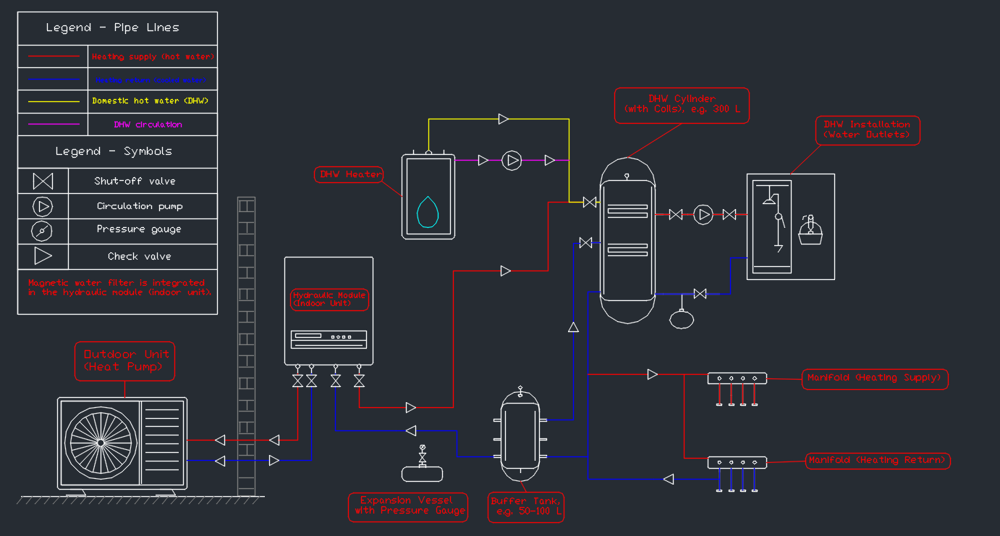
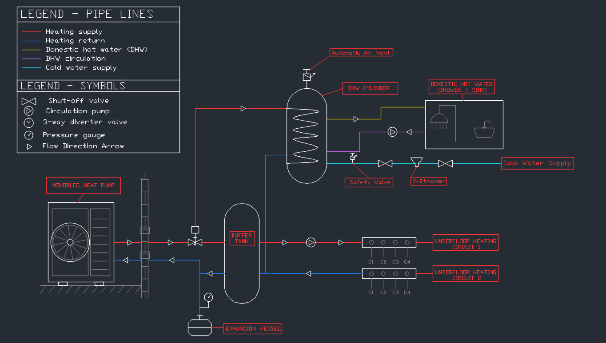
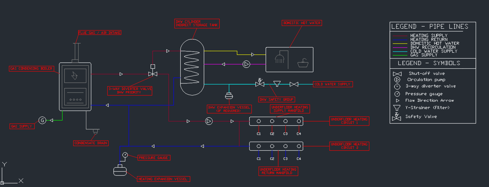
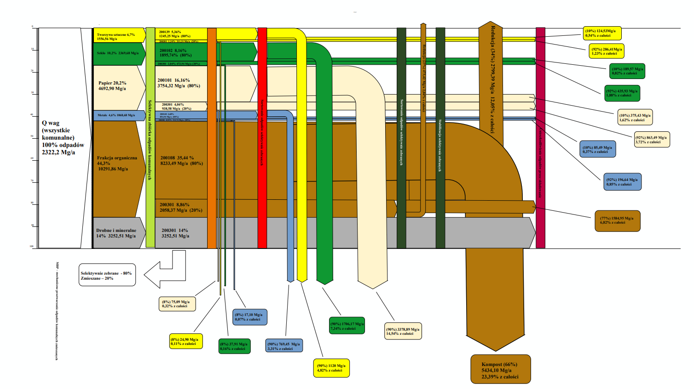
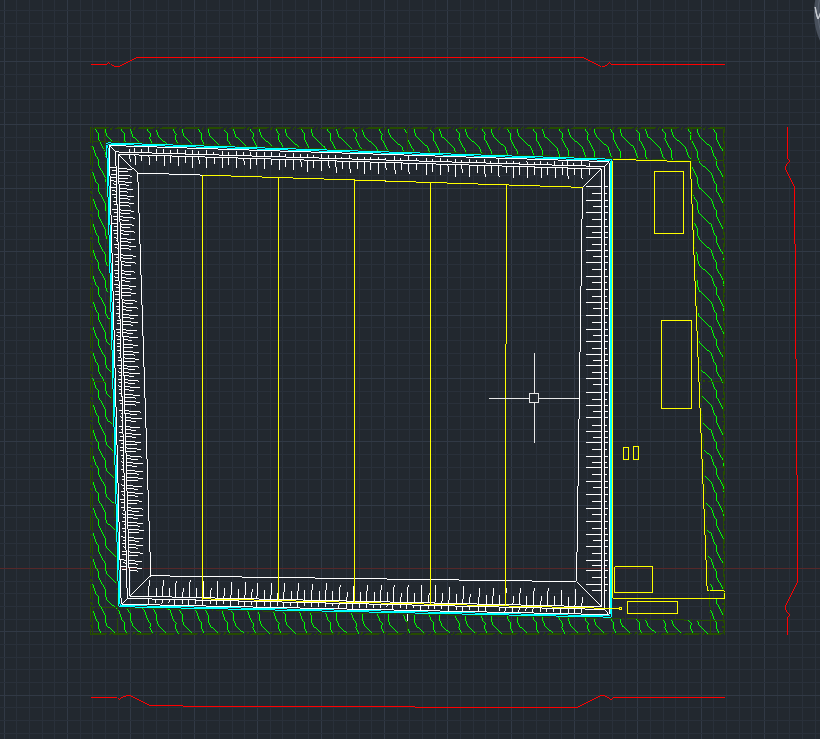
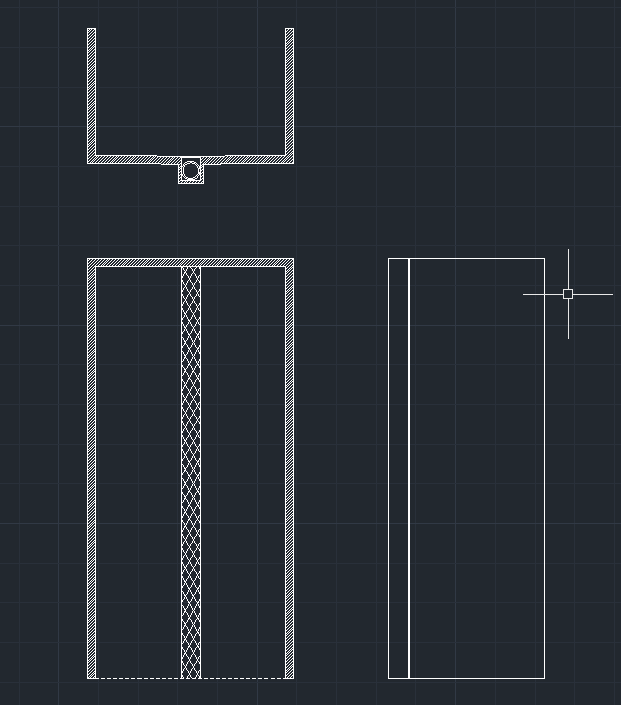
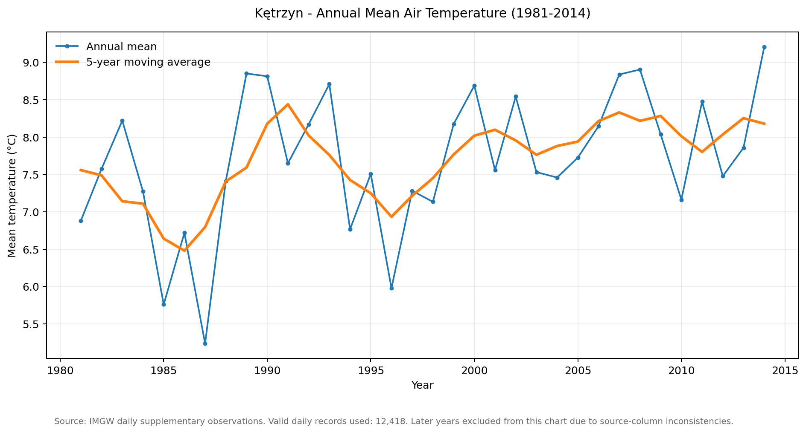
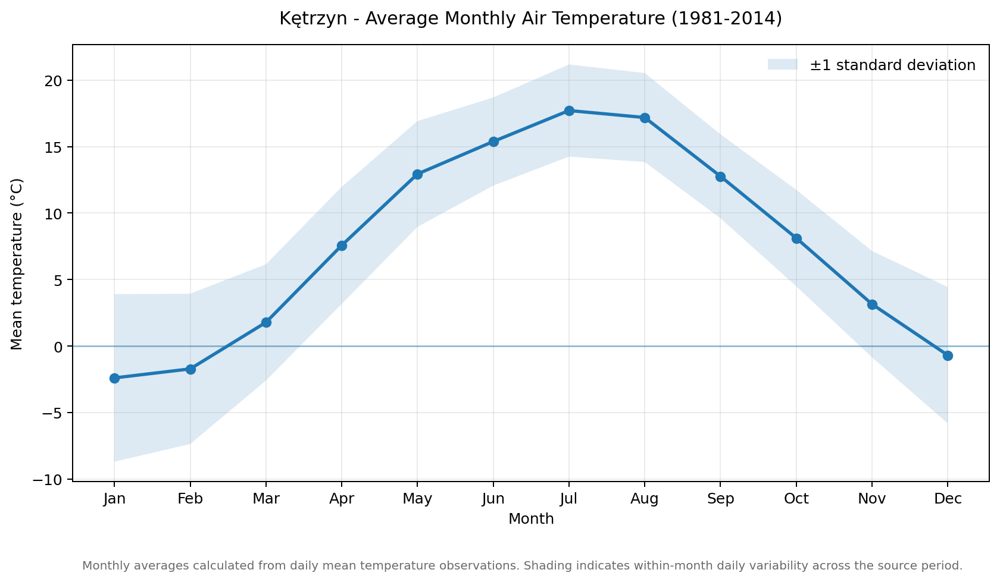
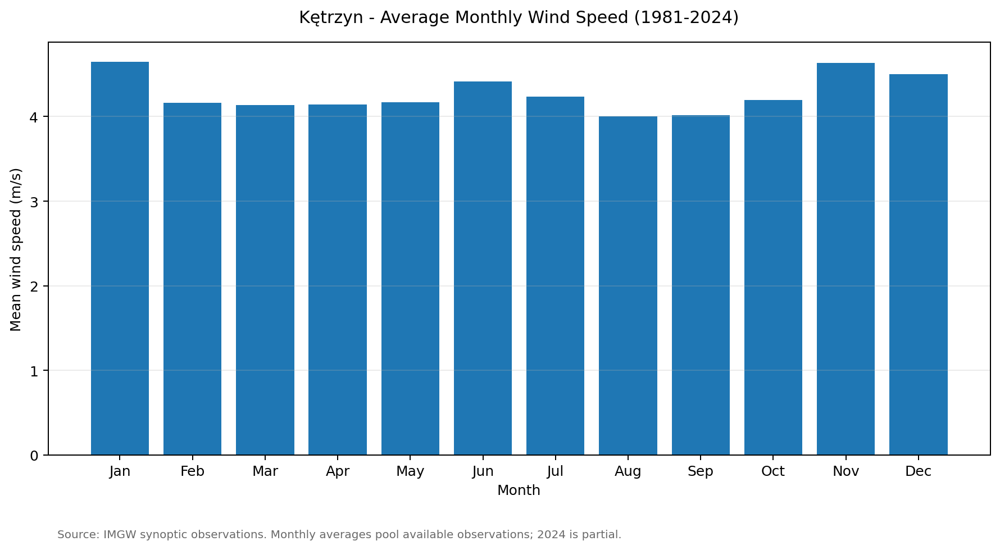
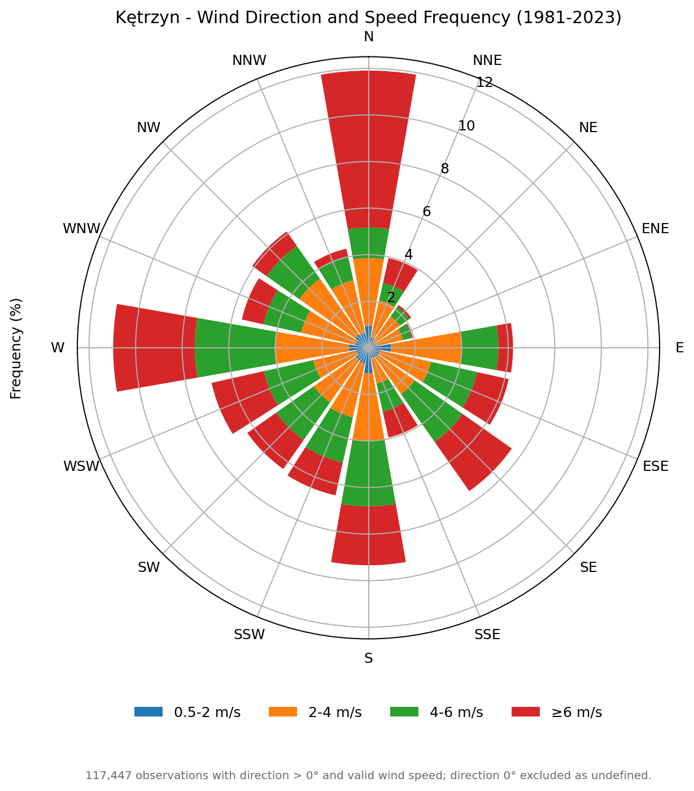

# Engineering Projects

A portfolio of engineering projects, most of which were completed during my university studies. The work covers **building services (HVAC)**, **renewable energy systems**, **environmental engineering**, and **climatological data analysis**. It combines 2D CAD drafting in AutoCAD, specialized engineering simulations, spreadsheet-based calculations, meteorological data processing, and technical reporting.

> **Background:** Most projects were originally completed as coursework during my engineering studies. Some were later extended or reorganized for portfolio presentation.
>
> **Scope:** All projects are educational and portfolio studies. Drawings, calculations, and simulation results are illustrative and are not construction, permitting, or installation documentation.

---

## Projects at a glance

| # | Project | Domain | Main tools | Deliverables |
|---|---|---|---|---|
| 01 | [AutoCAD Residential HVAC Systems](./01_AutoCAD_Residential_HVAC_Systems_Project/) | Building services / heating | AutoCAD | 3 DWG schematics and PNG previews |
| 02 | [Municipal Waste Management and Landfill Engineering](./02_Municipal_Waste_Management_Project/) | Environmental engineering | Excel, AutoCAD | 2 DWG drawings, 3 XLSX workbooks, Sankey diagram, technical report |
| 03 | [GeoT*SOL Heat Pump System Design](./03_GeoTSOL_Heat_Pump_System_Design/) | Heat pumps / energy simulation | GeoT*SOL 2025 R1 | 4 simulation reports (PDF) |
| 04 | [PV*SOL Photovoltaic System Design](./04_PVSOL_Photovoltaic_System_Design/) | Photovoltaics / energy simulation | PV*SOL 2025 | 4 simulation reports (PDF) |
| 05 | [T*SOL Solar Thermal System - Kindergarten](./05_TSOL_Kindergarten_Solar_Thermal_System/) | Solar thermal energy / DHW | T*SOL 2025 R1 | 2 simulation reports (PDF) |
| 06 | [Kętrzyn Climate Data Analysis](./06_Ketrzyn_Climate_Data_Analysis/) | Climatology / meteorological data analysis | Excel, Python, Matplotlib | 2 XLSX source files, 4 charts, technical report |

---

## 01 - AutoCAD Residential HVAC Systems

Three 2D schematics compare different ways of supplying space heating and domestic hot water (DHW) to a residential building with underfloor heating:

1. Air-to-water heat pump - split system (Panasonic Aquarea R32).
2. Air-to-water heat pump - monobloc system.
3. Gas condensing boiler system.

**Work performed:** equipment representation and symbols, orthogonal pipe routing, colour-coded heating, DHW and refrigerant lines, manifold connections, labels, leaders, and legends.

**Outcome:** three consistently drafted system schematics that allow the main system concepts to be compared.

### Drawing previews

<table>
  <tr>
    <td width="33%">
      
    </td>
    <td width="33%">
      
    </td>
    <td width="33%">
      
    </td>
  </tr>
  <tr>
    <td align="center">Split heat pump</td>
    <td align="center">Monobloc heat pump</td>
    <td align="center">Gas condensing boiler</td>
  </tr>
</table>

[Open project folder](./01_AutoCAD_Residential_HVAC_Systems_Project/)

---

## 02 - Municipal Waste Management and Landfill Engineering

A municipal waste management study for a town of approximately **79,000 inhabitants**, with an estimated annual waste stream of **23,232 Mg** and an organic fraction of **44.3%**.

The project covers:

- Waste generation and composition analysis.
- A waste-flow **Sankey diagram**, covering selective collection, sorting, stabilization, compost, and landfilled fractions.
- Preliminary sizing of **aerobic stabilization reactors**: approximately **7,394.67 Mg/year** of material to stabilize and an estimated configuration of **8 reactors**, each with a volume of approximately **234 m³**.
- Landfill forecasting for 2026-2041, with preliminary capacity and area analysis.
- Wind-rose and green-belt review.
- 2D CAD drawings of the **reactor** and **landfill basin**.

**Outcome:** a workflow from waste data analysis to a treatment concept and preliminary site layout. The technical report documents the methodology and identifies inconsistencies or limitations in the source data, rather than presenting uncertain inputs as verified facts.

### Selected project visuals

<table>
  <tr>
    <td width="50%">
      
    </td>
    <td width="50%">
      
    </td>
  </tr>
  <tr>
    <td align="center">Waste-flow Sankey diagram</td>
    <td align="center">Landfill forecast</td>
  </tr>
  <tr>
    <td colspan="2">
      <p align="center">
        
      </p>
    </td>
  </tr>
  <tr>
    <td colspan="2" align="center">Aerobic stabilization reactor drawing</td>
  </tr>
</table>

[Open project folder](./02_Municipal_Waste_Management_Project/) · [Read technical report](./02_Municipal_Waste_Management_Project/Report.md)

---

## 03 - GeoT*SOL Heat Pump System Design

A comparative simulation study of residential **air-to-water heat pump systems** created in **GeoT*SOL 2025 R1**. Four scenarios compare two household sizes (2+2 and 2+4) in two Polish locations: Olsztyn and Rzeszów.

| Scenario | Heated area | Heat pump SPF | Annual heat pump electricity | CO₂ avoided |
|---|---:|---:|---:|---:|
| 2+2 - Olsztyn | 116 m² | 3.0 | 4,728 kWh | 2,457 kg |
| 2+2 - Rzeszów | 116 m² | 3.2 | 4,166 kWh | 2,322 kg |
| 2+4 - Olsztyn | 130 m² | 2.9 | 6,516 kWh | 4,257 kg |
| 2+4 - Rzeszów | 130 m² | 3.0 | 6,437 kWh | 4,263 kg |

**Work performed:** configuration of heat pumps and hot-water storage, definition of space-heating and DHW demand, annual energy simulation, review of photovoltaic contribution, and comparison of system performance and environmental indicators.

**Outcome:** four comparable simulation scenarios showing annual energy demand, heat pump performance, electricity consumption and selected environmental indicators.

### Simulation reports

- [2+2 household - Olsztyn (PDF)](./03_GeoTSOL_Heat_Pump_System_Design/Dom%20(2%2B2)%20-%20Olsztyn%20-%20GeoTSOL.pdf)
- [2+2 household - Rzeszów (PDF)](./03_GeoTSOL_Heat_Pump_System_Design/Dom%20(2%2B2)%20-%20Rzesz%C3%B3w%20-%20GeoTSOL.pdf)
- [2+4 household - Olsztyn (PDF)](./03_GeoTSOL_Heat_Pump_System_Design/Dom%20(2%2B4)%20-%20Olsztyn%20-%20GeoTSOL.pdf)
- [2+4 household - Rzeszów (PDF)](./03_GeoTSOL_Heat_Pump_System_Design/Dom%20(2%2B4)%20-%20Rzesz%C3%B3w%20-%20GeoTSOL.pdf)

[Open project folder](./03_GeoTSOL_Heat_Pump_System_Design/)

---

## 04 - PV*SOL Photovoltaic System Design

A comparative design and simulation study of grid-connected residential photovoltaic systems created in **PV*SOL 2025**. Four scenarios cover two household sizes (2+2 and 2+4) and two Polish locations (Olsztyn and Rzeszów).

| Scenario | PV capacity | Annual production | Self-consumed energy | Exported energy | CO₂ avoided |
|---|---:|---:|---:|---:|---:|
| 2+2 - Olsztyn | 6.32 kWp | 6,326 kWh | 1,525 kWh | 4,801 kWh | 2,378 kg |
| 2+2 - Rzeszów | 5.14 kWp | 5,472 kWh | 1,420 kWh | 4,052 kWh | 2,062 kg |
| 2+4 - Olsztyn | 9.28 kWp | 9,730 kWh | 1,937 kWh | 7,793 kWh | 4,560 kg |
| 2+4 - Rzeszów | 8.70 kWp | 9,462 kWh | 1,850 kWh | 7,612 kWh | 4,435 kg |

**Work performed:** PV module and inverter selection, definition of module orientation and tilt, roof-area allocation, string configuration, climate-data review using Meteonorm 8.2, annual yield simulation, and financial analysis including investment cost, IRR, and estimated payback period.

**Outcome:** four comparable PV system simulations showing annual production, on-site energy use, grid exports, and selected financial and environmental indicators.

### Simulation reports

- [2+2 household - Olsztyn (PDF)](./04_PVSOL_Photovoltaic_System_Design/PVSOL%20(2%2B2)%20Olsztyn.pdf)
- [2+2 household - Rzeszów (PDF)](./04_PVSOL_Photovoltaic_System_Design/PVSOL%20(2%2B2)%20Rzesz%C3%B3w.pdf)
- [2+4 household - Olsztyn (PDF)](./04_PVSOL_Photovoltaic_System_Design/PVSOL%20(2%2B4)%20Olsztyn.pdf)
- [2+4 household - Rzeszów (PDF)](./04_PVSOL_Photovoltaic_System_Design/PVSOL%20(2%2B4)%20Rzesz%C3%B3w.pdf)

[Open project folder](./04_PVSOL_Photovoltaic_System_Design/)

---

## 05 - T*SOL Solar Thermal System Design - Kindergarten

A comparative simulation study of a **solar thermal system for domestic hot water (DHW)** in a kindergarten, created using **T*SOL 2025 R1**. Two scenarios compare system performance using climate data for Olsztyn and Rzeszów.

### Project scenarios

| Scenario | Location | Collector area | Installed collector power |
|---|---|---:|---:|
| 01 | Olsztyn | 100.5 m² | 48.86 kW |
| 02 | Rzeszów | 100.5 m² | 48.86 kW |

### Simulation results

| Scenario | Solar energy supplied to DHW | Solar coverage | CO₂ reduction | System efficiency |
|---|---:|---:|---:|---:|
| Olsztyn | 46,091.50 kWh/year | 48.0% | 9,490.58 kg/year | 41.6% |
| Rzeszów | 49,625.42 kWh/year | 55.6% | 10,205.44 kg/year | 42.9% |

**Work performed:** configuration of solar thermal collectors, definition of collector area and orientation, hot-water storage configuration, auxiliary boiler setup, annual solar energy simulation, and comparison of energy coverage and environmental indicators.

**System components:** 10 Viessmann Vitosol 200-F Typ XL10 collectors, a 7.5 m³ DHW storage tank, and a Viessmann Vitoradial 300-T auxiliary boiler rated at 313 kW.

### Simulation reports

- [Kindergarten - Olsztyn (PDF)](./05_TSOL_Kindergarten_Solar_Thermal_System/TSOL%20-%20Przedszkole%20-%20Olsztyn.PDF)
- [Kindergarten - Rzeszów (PDF)](./05_TSOL_Kindergarten_Solar_Thermal_System/TSOL%20-%20Przedszkole%20-%20Rzesz%C3%B3w.pdf)

[Open project folder](./05_TSOL_Kindergarten_Solar_Thermal_System/)

---

## 06 - Kętrzyn Climate Data Analysis (1981-2024)

An exploratory climatological study based on historical meteorological observations from the **Kętrzyn weather station in Poland**. The project uses daily and synoptic datasets covering different periods between 1981 and 2024.

The analysis focuses on selected weather parameters, seasonal variability and historical patterns in air temperature, wind speed and wind direction.

### Scope of analysis

- Annual and monthly mean air temperature.
- Seasonal temperature variability.
- Monthly mean wind speed.
- Wind direction and frequency distribution.
- Review of historical meteorological observations.
- Data organization, filtering and quality assessment.
- Preparation of statistical visualizations.

### Selected climate visualizations

<table>
  <tr>
    <td width="50%">
      
      <p align="center">Annual mean temperature (1981-2014)</p>
    </td>
    <td width="50%">
      
      <p align="center">Monthly temperature profile</p>
    </td>
  </tr>
  <tr>
    <td width="50%">
      
      <p align="center">Monthly mean wind speed</p>
    </td>
    <td width="50%">
      
      <p align="center">Wind rose (1981-2023)</p>
    </td>
  </tr>
</table>

### Main observations

The available temperature series shows year-to-year variability, with generally higher annual temperature levels in parts of the later analyzed period. The monthly profile confirms the seasonal temperature cycle, with the warmest conditions in July and August and the coldest in January and February.

The monthly wind speed profile shows relatively moderate seasonal variation. The wind rose illustrates the frequency of different wind directions and speed classes, with noticeable contributions from northern and western sectors.

**Outcome:** a set of climatological visualizations and a technical report based on historical meteorological observations, including data preparation, quality review and interpretation of selected weather patterns.

### Data and files

- `Source_Data/KETRZYN_DOBOWE_SD.xlsx` - daily meteorological observations.
- `Source_Data/KETRZYN_DOBOWE_SDT.xlsx` - supplementary daily observations.
- `Charts/` - four meteorological visualizations.
- `Report.md` - technical report describing the methodology, observations and limitations.

The large original synoptic workbook used for the wind analysis is not included in the repository due to its file size. The resulting wind visualizations are included.

[Open project folder](./06_Ketrzyn_Climate_Data_Analysis/) · [Read climate analysis report](./06_Ketrzyn_Climate_Data_Analysis/Report.md)

---

## Skills and tools demonstrated

### CAD and technical drawing

- **AutoCAD:** 2D drafting, layers, line types, symbols, annotations, leaders, legends, and DWG documentation.
- HVAC schematic drafting, including equipment representation, pipe routing, and manifold connections.
- Environmental and civil engineering drawings, including reactor and landfill layouts.

### Energy and building-services simulation

- **GeoT*SOL 2025 R1:** heat pump system configuration and annual performance simulation.
- **PV*SOL 2025:** PV system configuration, module and inverter selection, yield simulation, and financial analysis.
- **T*SOL 2025 R1:** solar thermal collector configuration, DHW system simulation and solar energy contribution analysis.
- Interpretation of SPF, solar coverage, PV production, self-consumption, grid exports, IRR, and estimated CO₂ reductions.
- Comparison of modeled scenarios using different locations and system assumptions.

### Environmental and waste engineering

- Municipal waste generation and composition analysis.
- Mass-flow analysis and Sankey diagrams.
- Aerobic stabilization and preliminary reactor sizing.
- Landfill forecasting, capacity and area estimation.
- Wind-rose review and green-belt planning.

### Climatology and meteorological data analysis

- Processing and inspection of historical meteorological datasets.
- Daily and monthly temperature aggregation.
- Wind speed and direction analysis.
- Preparation of temperature charts and wind roses.
- Data-quality review and identification of incomplete or inconsistent observations.

### Data, calculations, and documentation

- **Excel:** engineering calculations, forecasting, data organization, and result summaries.
- **Python:** data processing and chart generation.
- **Matplotlib:** meteorological data visualization.
- Technical reporting in Markdown.
- Transparent documentation of source-data limitations, assumptions and modeling constraints.

---

## Repository structure

```text
04_Engineering-Projects/
├── 01_AutoCAD_Residential_HVAC_Systems_Project/
│   ├── Drawings/        # 3 DWG schematics
│   ├── Previews/        # PNG previews
│   └── README.md
│
├── 02_Municipal_Waste_Management_Project/
│   ├── Drawings/        # Reactor and landfill basin (DWG)
│   ├── Diagrams/        # Waste-flow diagram
│   ├── Previews/        # PNG previews
│   ├── Source_Files/    # 3 XLSX workbooks
│   ├── Report.md
│   └── README.md
│
├── 03_GeoTSOL_Heat_Pump_System_Design/
│   ├── 4 simulation reports (PDF)
│   └── README.md
│
├── 04_PVSOL_Photovoltaic_System_Design/
│   ├── 4 simulation reports (PDF)
│   └── README.md
│
├── 05_TSOL_Kindergarten_Solar_Thermal_System/
│   ├── 2 simulation reports (PDF)
│   └── README.md
│
├── 06_Ketrzyn_Climate_Data_Analysis/
│   ├── Charts/          # 4 climate charts
│   ├── Source_Data/     # 2 XLSX workbooks
│   ├── Report.md
│   └── README.md
│
└── README.md
```

## Notes and limitations

- All projects are educational and portfolio studies, not verified commercial designs or construction documentation.
- GeoT*SOL, PV*SOL and T*SOL results are software simulation outputs based on the assumptions documented in the individual reports. Actual system performance may differ from modeled results.
- The GeoT*SOL reports use the term *geothermal system* in their titles, but the simulated heat source is **ambient air** and the modeled equipment is an **air-to-water heat pump**.
- The 2+4 GeoT*SOL reports use an electricity load profile labelled **1-person household** for the PV-related household load. The 2+4 PV*SOL reports also use a **1-person household** electricity profile.
- The T*SOL reports use a domestic hot water demand profile labelled as a **multifamily residential building**, rather than a kindergarten. The specified daily water consumption also differs between the Olsztyn and Rzeszów scenarios. These input limitations should be considered when comparing the results.
- The PV*SOL and T*SOL reports were generated using non-commercial editions of the software.
- The Kętrzyn climate analysis is exploratory. The annual temperature visualization is limited to 1981-2014 due to source-data inconsistencies. The wind rose covers 1981-2023, while the monthly wind speed chart uses available synoptic observations.
- The original large synoptic workbook used for wind analysis is not included in the repository due to its size.
- Personal names, addresses, company details, and other identifying information shown in the simulation reports are fictional and were created for demonstration purposes.
- Known source-data inconsistencies and modeling limitations are documented in the relevant project reports or notes.

---

**Focus areas:** HVAC · Renewable Energy · Solar Thermal · Environmental Engineering · Climatology · AutoCAD

**Portfolio:** 6 projects · 5 DWG drawings · 10 simulation reports (PDF) · 5 XLSX workbooks · 4 climate charts
